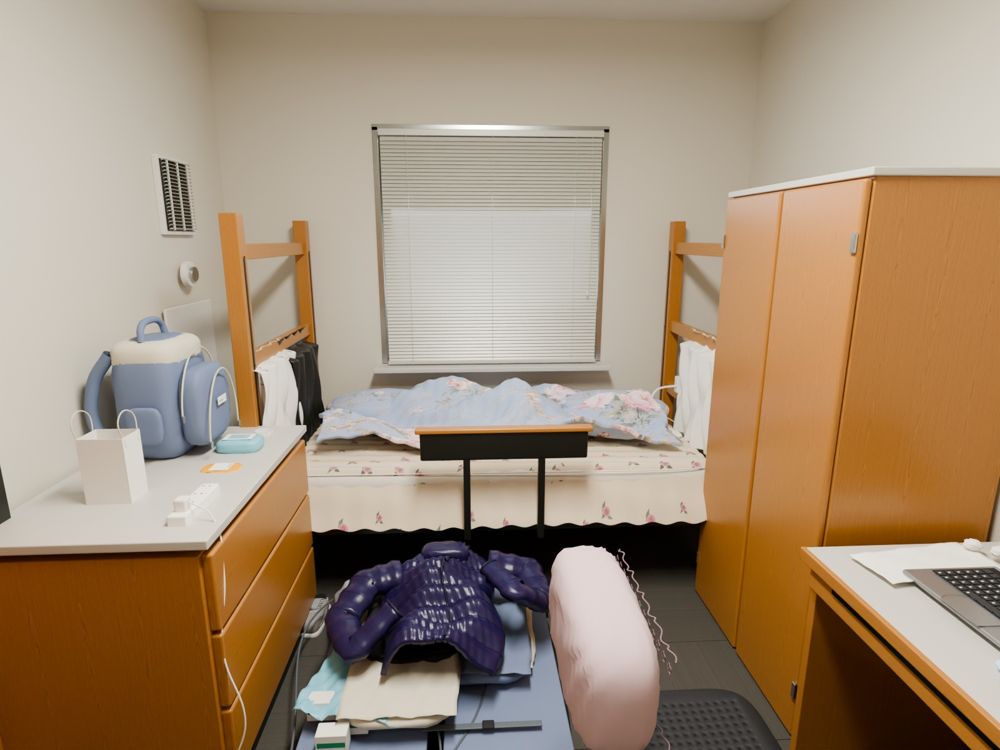

# Room Replica

[](https://github.com/appleweiping/room-replica/actions/workflows/validate.yml)
[](https://github.com/appleweiping/room-replica/actions/workflows/pages.yml)

**把照片里的日常空间，做成可以走近观察的三维房间。**

A complete, editable Blender reconstruction of a lived-in student room, guided by sixteen resident photographs. Native Cycles renders, a portable glTF scene, and an interactive browser companion are delivered together.



**[打开交互演示 / Live demo](https://appleweiping.github.io/room-replica/)** · **[Blender 场景](scene/room.blend)** · **[浏览器模型](demo/public/models/room.glb)** · **[官方参考资料](docs/REFERENCE_RESEARCH.md)**

无需运行代码即可使用 [Release 下载包](https://github.com/appleweiping/room-replica/releases/latest)：原生 `.blend`、独立 `.glb`、四视角成片和包含源码的完整项目包。每个发布附件提供 SHA-256 校验值。

## 交付内容

| 内容 | 文件 | 用途 |
| --- | --- | --- |
| 原生工程 | [`scene/room.blend`](scene/room.blend) | 可编辑几何、材质、分组、灯光、四个预设相机；贴图打包在文件内 |
| 交互模型 | [`demo/public/models/room.glb`](demo/public/models/room.glb) | 嵌入贴图的 glTF 2.0 单文件，可用 Three.js / Blender 等打开 |
| 最终成片 | [`renders/`](renders) | 卧室、入口厨房、书桌、空间剖切四个 Cycles 视角；1600 × 1200，64 samples，降噪 |
| 完整演示 | [`demo/`](demo) | 中英界面、相机预设、剖切、曝光、画质、截图和模型下载 |
| 可重复构建 | [`scripts/build_scene.py`](scripts/build_scene.py) | 从零建立同一房间，固定种子，不依赖私有照片 |
| 材质来源 | [`assets/ASSET_SOURCES.json`](assets/ASSET_SOURCES.json) | CC0 贴图作者、URL、下载校验信息 |
| 场景清单 | [`scene/scene-manifest.json`](scene/scene-manifest.json) | 尺寸依据、物件/材质数量、相机参数、版本 |
| 验收记录 | [`docs/validation.json`](docs/validation.json) | 文件完整性、模型结构、嵌入资源、成片同步检查 |
| 网页验收 | [`docs/browser-validation.json`](docs/browser-validation.json) | 实际浏览器交互与桌面/窄屏布局检查 |

## 复刻了什么

房间按照照片中的关系布置：窗下横向单人床，左右两侧的三抽柜和衣柜，靠衣柜的书桌、入口厨房、独立凹槽洗手台及侧门。深灰地毯砖和入口浅色地砖保留分界，墙体保留门窗开口、窗台、黑色踢脚线、设备检修板和通风格栅。

- **家具与五金**：橡木柜门框线、凹面板、抽屉间隙、台面封边、门铰、门锁、闭门器、床架连接件。
- **厨房与洗手台**：螺旋电炉盘、微波炉网窗和按键、双门小冰箱、真实凹陷的金属水盆、排水口、弯管龙头及反射镜面。
- **织物**：有厚度和褶皱的碎花床单、蓝色花卉被褥、床边搭挂的衣物、格纹毛巾、椅子靠垫和行李中的绗缝外套。
- **生活物件**：键盘独立按键的笔记本、平板、手机、鼠标、纸巾卷、线缆、插线板、背包、零食、鞋、透明收纳箱及两种状态的行李箱。
- **材质和光线**：真实木纹 PBR 来源、顺着部件长度生长的木纹、细微墙面/顶棚起伏、织物纹理、金属粗糙度、顶灯和百叶窗冷暖混合光。

蓝色被套采用依据参考照片生成的花卉纹理，单张映射到布料表面；[生成提示词和来源记录](docs/fabric-generation.md) 随工程提供。褶皱、厚度和光影来自三维几何及 Cycles，生成图没有用来替代场景渲染。

## 真实性与尺寸依据

这是根据多张照片进行的**人工参数化建模**，并非激光扫描或摄影测量网格。目标是保留这个房间的布局、日常状态和材料特征。遮挡部分、细小标签、柔性织物的具体褶皱均为依据照片重建的近似；电脑屏幕和门上公告使用原创通用内容。

UMN 官方 [Yudof 页面](https://housing.umn.edu/yudof) 给出床垫 **36 × 80 英寸（0.9144 × 2.032 米）**，模型据此定标。未找到该具体房间的公开实测平面图；本版室内主体按 **3.00 × 4.15 × 2.82 米**估算，洗手台凹槽另计。官方公布的 efficiency 平均面积没有清晰说明统计边界，因此没有直接套到这一个私人房间上。完整证据和限制见 [参考核查](docs/REFERENCE_RESEARCH.md)。

**Cycles 成片是材质与光照的主版本。** 浏览器使用实时 PBR、辅助灯光和环境反射，镜面、微观凹凸、透明介质以及间接光与 Cycles 有差别。GLB 可以观察与交互，不能替代最终渲染。没有将任一自动指标表述为“与照片完全一致”。

## 快速运行

### 直接打开原生场景

1. 安装 **Blender 4.5 LTS**（实际构建版本：4.5.13 LTS）。
2. 打开 `scene/room.blend`。所有使用中的图像已打包。
3. 默认是卧室相机，数字键盘 `0` 进入相机视图。将时间线切到第 `1 / 61 / 121 / 181` 帧，会通过相机标记启用 `Bedroom / Kitchen / Desk / Overview`；仅在 Outliner 选中相机不会更改渲染视角。
4. 通过下方渲染脚本输出相应视角；总览会自动隐藏前墙、左墙和顶棚。

### 本地交互演示

```sh
git clone https://github.com/appleweiping/room-replica.git
cd room-replica/demo
npm ci
npm run dev
```

打开终端显示的本地地址。需要 **Node.js 20.19+ 或 22.12+**，推荐 Node 22 LTS。模型和库从本地加载，不依赖第三方 CDN。首次加载时间取决于网速和设备；弱显卡可降低画质，或使用成片画廊。

```sh
npm run check
npm run build
npm run preview
```

构建结果在 `demo/dist/`，可发布到普通静态托管。Vite 使用相对资源地址，可部署到 GitHub Pages 子目录。

## 从零重建

所需贴图已经随仓库提供；正常构建不需要下载素材，不需要原始照片，也不需要安装额外 Python 包。Blender 自带 Python 即可执行场景构建。

```sh
blender --background --python-exit-code 1 --python scripts/build_scene.py -- \
  --render all --resolution 1600 --samples 96
```

Windows PowerShell 可指定 Blender 绝对路径：

```powershell
./scripts/build.ps1 -Blender 'C:\Program Files\Blender Foundation\Blender 4.5\blender.exe' -Render all -Resolution 1600 -Samples 96
```

脚本依次建立几何和材质、验证基本场景结构、打包保存 `.blend`、导出 `.glb`、按需渲染。只建模型可用 `--render none`；只校对几何可加 `--skip-export`。

如果使用直接 Blender 命令，渲染后同步画廊文件：

```powershell
Copy-Item renders/*.jpg demo/public/renders/
Copy-Item scene/scene-manifest.json demo/public/scene-manifest.json
```

更改织物原创图案时，需要 Python、Pillow 和 NumPy：

```sh
python -m pip install -r requirements-textures.txt
python scripts/make_textures.py
```

这些依赖用于重新生成床单、地毯、通用公告和备用蓝色图案，正常重建无需安装。正式使用的 `blue_floral_art.png` 是已经提交的 AI 辅助素材，此脚本不会重建它；提示词见 `docs/fabric-generation.md`。第三方木纹贴图的下载来源和校验值在 `assets/` 中。

### 仅重新渲染现有场景

```sh
blender --background scene/room.blend --python-exit-code 1 --python scripts/render.py -- \
  --view bedroom --resolution 1600 --samples 96
```

支持 `bedroom / kitchen / desk / overview / all`。更高质量可用 `--resolution 2400 --samples 256`；成本取决于硬件、透明物件和反射。脚本固定使用 CPU，可在没有独立显卡的机器运行。使用受支持的 GPU 时，请在 Blender 界面配置设备并将 Cycles 的 Device 改为 GPU Compute 后渲染；仅更改 Preferences 不会改变此脚本的 CPU 设置。

单视角输出用于局部预览；更新正式交付时请使用 `--view all`，再同步四张图到 demo。发布校验要求四视角完整记录，且实际图片至少为 1600 × 1200、采样预算至少为 64。临时预览可通过 `--stats-file .local/preview-stats.json` 保留原批次记录，但不要将覆盖后的预览图直接发布。

## 工程组织

```text
room-replica/
├── scene/                 # Packed .blend and measured/estimated metadata
├── renders/               # Four final Cycles JPEG images
├── assets/                # Original textile graphics and licensed wood maps
├── scripts/
│   ├── common.py          # Modeling primitives, UVs, material/camera helpers
│   ├── build_scene.py     # Architecture, furniture, bedding and assembly
│   ├── props.py           # Everyday objects, cloth, electronics and luggage
│   ├── make_textures.py   # Original deterministic textile graphics
│   ├── render.py          # Render existing master without rebuilding geometry
│   └── validate_delivery.py
├── demo/                  # Vite / Three.js interactive viewer
├── docs/                  # Research, production notes and validation evidence
└── references/            # Private local photographs; excluded from Git
```

场景使用米、Z 轴向上；入口是 `y=0`，窗户是 `y=4.15`，衣柜/书桌为 `+x` 一侧。glTF 转为 Y 轴向上，坐标映射为 `(x, z, -y)`。物件通过描述性名称和集合分组，便于逐件替换或重新校准。家具尺寸集中在各建模函数中，场景清单记录最终结果；它不是任意户型自动生成器。

## 验证与发布

原生场景审计可以独立复跑，不重建、不渲染、不保存场景；检查贴图打包、尺寸、四个相机、物件尺度和水盆内部三点射线，并将原生文件的 SHA-256 与检查结果写入 `docs/native-validation.json`：

```sh
blender --background scene/room.blend --python-exit-code 1 --python scripts/audit_scene.py
```

独立运行 Khronos 官方 glTF 2.0 标准校验，不改动演示依赖；完整原始报告和模型指纹分别写入 `docs/gltf-validation.json` 与 `docs/gltf-validation-run.json`：

```sh
npm install --prefix .local/gltf-validation --no-save --ignore-scripts --registry=https://registry.npmjs.org gltf-validator@2.0.0-dev.3.10
node scripts/validate_gltf.cjs
```

```sh
python -m compileall -q scripts
python scripts/validate_delivery.py
cd demo
npm ci
npm run check
npm run build
```

完整性脚本独立读取 GLB 容器，检查文件长度、缓冲区边界、嵌入贴图、有限坐标边界、关键家具、原生文件、四张 JPEG、视角重复、渲染完成记录和画廊同步。[原生场景验收](docs/native-validation.json) 另核对贴图打包、相机、床垫尺度和镜头/鞋孔等小部件的尺寸。[浏览器验收](docs/browser-validation.json) 记录实际交互检查。它们不能自动证明照片拟合程度，视觉检查仍是必要步骤。

GitHub Actions 提供交付检查和 Pages 发布两个流程。修改公开模型后应重新构建、查看四个相机视角、运行检查，再更新成片；只修改网页时不需要重新渲染 Blender 场景。

## 许可和隐私

原创代码和随附原创模型资产使用 [MIT](LICENSE)；第三方木纹保持其 **CC0** 许可，并在 [素材清单](assets/ASSET_SOURCES.json) 中逐项记录。原始照片不随公开仓库分发，也没有向本仓库授予照片再许可。公开资产不包含原始照片路径、私人电脑屏幕内容或原图 EXIF。

当前改进分支中的照片衍生贴图按各自目录的 `PROVENANCE.json` 和 README 标注来源、遮罩、推断区域及残留拍摄光照。它们属于估计表面颜色，不能称为实测反射率；其中照片区域、商品图案与商标保留原有权利，不适用本项目的 MIT 或第三方 CC0 许可。

This project is an independent visual reconstruction. It is not an official university room survey or an affiliation claim. Native editable assets, reproducible source, offline renders and a self-contained web demo are included; dimensional accuracy beyond the published mattress anchor is not asserted.
