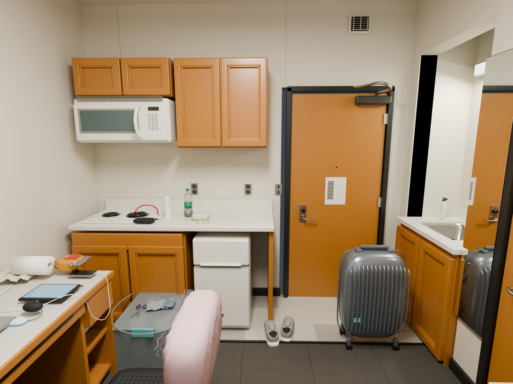
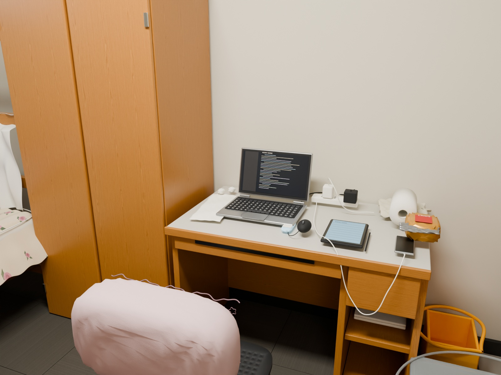
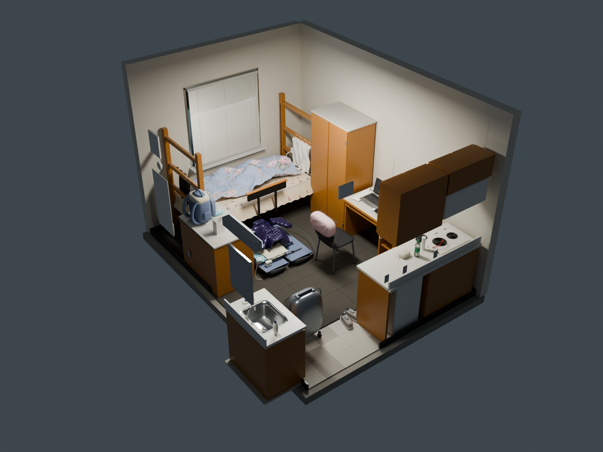
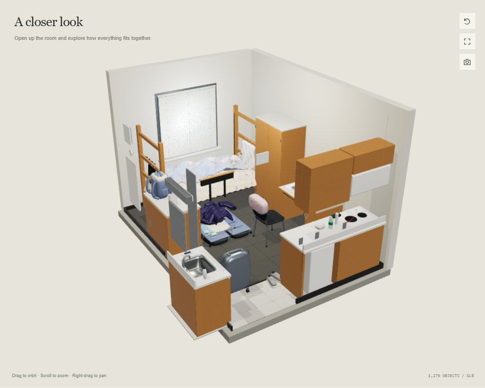
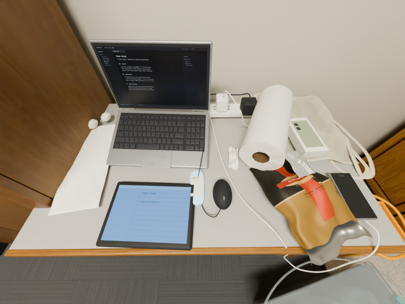
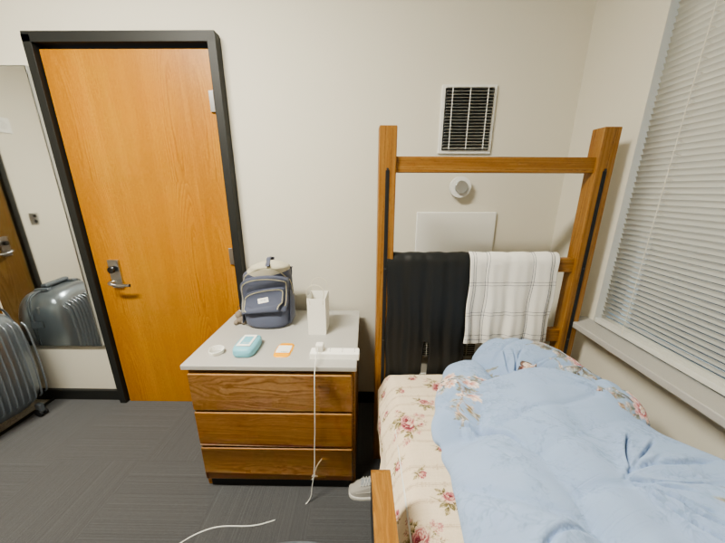

# Room Replica

My dorm room rebuilt in Blender from 16 phone photos, with Cycles renders and a 3D viewer that runs in the browser.

**[Open the 3D viewer](https://appleweiping.github.io/room-replica/)** · [Downloads](https://github.com/appleweiping/room-replica/releases/tag/v1.0.0) · [中文说明](#中文说明)


| Kitchen and entrance | Desk | Cutaway overview |
| --- | --- | --- |
|  |  |  |

All four images are Blender Cycles renders at 1600 × 1200 with 64 samples. None of them is a photo.

## What this is

I wanted to see how close I could get to a real, lived-in room by modelling it by hand from ordinary photos: no laser scanner and no photogrammetry mesh. The result had to stay editable. Every cabinet door, cable, snack bag and folded jacket is a separate named Blender object, created by Python scripts that rebuild the whole scene from nothing.

- **`scene/room.blend`**: the editable scene (v1) with all textures packed. Opens in Blender 4.5 LTS.
- **`renders/`**: the four Cycles renders above.
- **`demo/`**: the Three.js viewer, hosted on GitHub Pages. You can orbit the whole room with the near walls cut away, jump to the bedroom, kitchen and desk cameras, and change the light and exposure. It loads a 6 MB compressed model. The full 42 MB `room.glb` is on the [v1.0.0 release](https://github.com/appleweiping/room-replica/releases/tag/v1.0.0).
- **`scripts/`**: `build_scene.py` and about 40 modules it calls (geometry, materials, lights, cameras), plus `render.py`, `check_assets.py` and the web-model compressor.
- **`assets/`**: textures. They are CC0 wood from Poly Haven, patterns drawn by script, surfaces sampled from my photos, and a few AI-generated prints for the bedding, the pillowcase and one oak veneer ([AI_TEXTURES.md](docs/AI_TEXTURES.md)). [assets/README.md](assets/README.md) says where each texture came from.



## How I built it

1. **Layout from photos.** I took 16 photos from different spots in the room. The only real dimension I had was the bed, a standard Twin XL mattress (36 × 80 in, 0.9144 × 2.032 m). Everything else is scaled from the photos around it. The v1 room is 3.00 × 4.15 × 2.82 m, which is an estimate and not a measurement.
2. **Everything as code.** `build_scene.py` builds the walls, the window and its blind slats, the bed frame and its bolts, the wardrobe and dresser (with rails, stiles and bevels), the kitchenette, the microwave, the coil burners, the sink basin, the bedding and the clutter. It uses a fixed random seed, so every run gives the same scene. My photos are not needed to rebuild it.
3. **Camera calibration.** For a later revision I ran COLMAP on the photos. It registered 13 of the 15 non-ceiling photos (the ceiling shot was left out), and I used those camera poses to correct the layout and to render from the exact photo viewpoints for side-by-side comparison. That moved the room estimate to 3.33 × 4.54 × 3.035 m. See [CALIBRATION.md](docs/CALIBRATION.md).
4. **Materials.** Poly Haven red oak veneer with an amber stain node, wood and packaging sampled from my photos for the dresser and desk items, and AI-generated prints for the duvet and pillowcase. Folds and lighting always come from the geometry and Cycles, never from a texture.
5. **Rendering.** Cycles on a laptop CPU (Intel i5-1240P, 12 threads). The bedroom view took 25 minutes ([`render-stats.json`](renders/render-stats.json)).
6. **Web.** Export to glTF, compress it with meshopt from 42 MB to 6 MB, and view it with Three.js using the cameras authored in Blender. More details are in [PRODUCTION.md](docs/PRODUCTION.md).

## Versions

The `.blend`, the four renders and the web model in this repository are **v1** (September 2026). After v1 I kept refining in the source: the calibrated layout, wood sampled from photos, better bedding, desk items and package prints. The last full build of that work, "r10", is attached to the [v1.1.0-closeout release](https://github.com/appleweiping/room-replica/releases/tag/v1.1.0-closeout) as a 161 MB `.blend`. Running `build_scene.py` on the current `main` builds this later revision, not v1. Two r10 preview renders (800 × 600, 32 samples):

| Desk (r10) | Dresser and bed (r10) |
| --- | --- |
|  |  |

## Where it falls short

It still looks like CG up close. The folded duvet, the pile of clothes, the backpack's shape, the transparent plastic and some of the lighting and colour are clearly off compared with the photos. The room's size is estimated. The browser viewer uses its own lights and tone mapping, so it looks flatter than the Cycles renders. I stopped iterating at r10 because each further round cost a lot of time for small gains.

**Why not photogrammetry or Gaussian splats?** A phone scan (Polycam, RealityScan) or a splat would look more photographic for far less work. But the result is one fused mesh or a point cloud: you can't open the wardrobe, move the suitcase or relight the room. Making the scene editable was the point of this project.

## Run it

**Viewer** (Node 20.19+ or 22.12+):

```sh
git clone https://github.com/appleweiping/room-replica.git
cd room-replica/demo
npm ci
npm run dev            # http://127.0.0.1:5173
```

**Rebuild the scene** (Blender 4.5 LTS, no extra Python packages):

```sh
blender --background --python-exit-code 1 --python scripts/build_scene.py -- --render none
blender --background scene/room.blend --python-exit-code 1 --python scripts/render.py -- \
  --view all --resolution 1600 --samples 64
```

`build_scene.py` writes `scene/room.blend` and the full `scene/room.glb`. Rendering all four views overwrites `renders/` and took about an hour on my laptop. `cd scripts/web-model && npm install && npm run build` regenerates the compressed web model.

**Checks** (no Blender needed, these run in CI):

```sh
python -m unittest discover -s tests
python scripts/check_assets.py     # renders, demo copies, web model, manifest
```

## Privacy

The original photos are not in the repository. The laptop and tablet screens and the door notice show generic graphics, not what was really there.

## License

The code is MIT ([LICENSE](LICENSE)). The Poly Haven textures are CC0, and [assets/README.md](assets/README.md) lists their sources. My original photos are not in the repository and are not licensed. The textures sampled from them (four folders under `assets/textures/`, listed in the same file) are not covered by MIT or CC0, and any product artwork or trademarks they show belong to their owners.

## 中文说明

这是我按 16 张手机照片在 Blender 里手工参数化重建的宿舍房间。所有家具、杂物和织物都是可编辑的独立对象，由 Python 脚本从零生成。仓库里的 `scene/room.blend`、四张 Cycles 渲染图和网页模型是 v1 版本。之后的多视角标定和材质改进在源码里，最后一次完整构建（r10）在 v1.1.0-closeout Release 中下载。唯一的实测尺寸是标准 Twin XL 床垫（36 × 80 英寸），其余尺寸都是按照片估算的。床品褶皱、衣物堆和背包等细节仍然能看出是 CG。在线三维浏览：https://appleweiping.github.io/room-replica/
